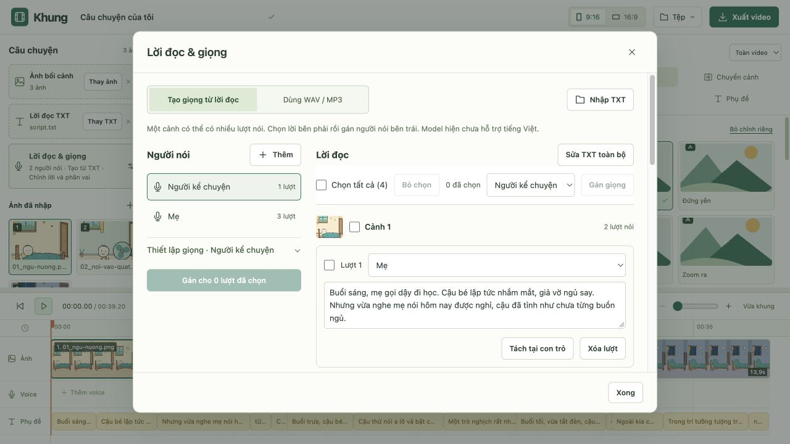
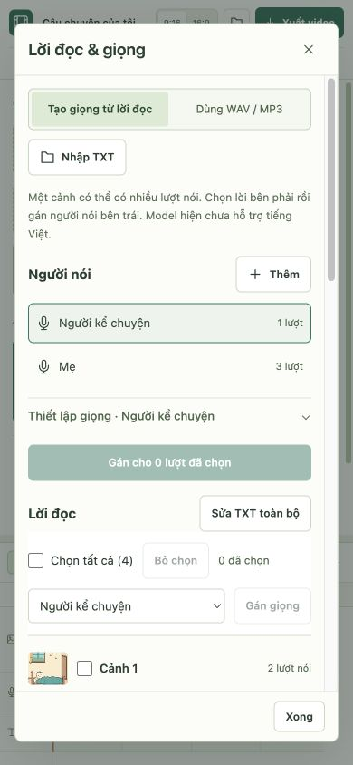

# Lời đọc và nhiều giọng trong một cảnh

## Kế hoạch

1. Gộp chỉnh TXT, nguồn voice và thiết lập TTS vào cửa sổ Lời đọc & giọng.
2. Thư viện người nói: tên dễ nhớ + preset server hoặc WAV/MP3 clone. Giữ model, ngôn ngữ, định dạng và thông số nâng cao chung.
3. Các lượt nói theo cảnh, chọn từng lượt/chọn cả cảnh/chọn tất cả, gán giọng hàng loạt, thêm hoặc tách lượt trong một cảnh.
4. Lưu phân vai cùng dự án; TXT sạch vẫn là nguồn lời phụ đề. Kiểm tra phân vai khớp TXT trước khi gọi API.
5. Tạo/cache từng lượt, ghép thành một voice/cảnh theo thứ tự. WAV trung gian cho cảnh nhiều giọng, MP3 chỉ mã hóa sau khi ghép.
6. Kiểm tra có mục tiêu: schema, cache, đổi giọng, ghép âm thanh, tương thích dự án cũ. Không gọi API thật hoặc tải model.

## Cách dùng đã triển khai

- Bấm **Lời đọc & giọng** ở cột tài nguyên; hàng Voice/Lời đọc trên timeline cũng mở cùng cửa sổ.
- Chọn **Tạo giọng từ lời đọc** hoặc **Dùng WAV / MP3**. Nhập TXT ngay trong cửa sổ hoặc sửa TXT toàn bộ; bản TXT thô chỉ được lưu sau khi bấm **Áp dụng TXT**. Đổi TXT toàn bộ đặt lại phân vai, giữ thư viện người nói.
- **Người kể chuyện** là giọng mặc định cho TXT cũ. Bấm **Thêm** để tạo người nói, đặt tên (Mẹ, Bé…), mở **Thiết lập giọng** và chọn preset hoặc file clone. API không có danh mục preset; tên giọng phải có trên server. File mẫu có thể nghe trực tiếp.
- Mỗi cảnh hiển thị lời và dropdown người nói. Đặt con trỏ trong lời và bấm **Tách tại con trỏ** để chia hai lượt; hoặc **Thêm lượt nói** để nhập lời mới. Thứ tự lượt là thứ tự phát, không tạo cảnh ảnh mới.
- Có chọn từng lượt, chọn cả cảnh, chọn tất cả, bỏ chọn. Chọn giọng rồi **Gán giọng** trên thanh chọn (vẫn ở trên khi cuộn), hoặc dùng nút gán tại thư viện. Các lượt ngoài vùng chọn giữ nguyên.
- Xóa người nói gán các lượt của họ về Người kể chuyện. Không xóa lời. Xóa lượt xóa nội dung lượt đó; mỗi cảnh giữ ít nhất một lượt.
- Model/ngôn ngữ/định dạng/thông số chung trong **Thiết lập TTS**, thu gọn mặc định. Không có model/ngôn ngữ riêng cho từng người nói trong bản này. TTS theo tài liệu hiện không hỗ trợ tiếng Việt.
- Bấm **Tạo / cập nhật voice**, nghe và tải theo cảnh; xuất video cũng tự tạo khi cần. Lượt không đổi dùng cache. Phân vai lưu với draft/dự án sau khi dựng; mẫu dựng giữ thư viện giọng và thông số, bỏ nội dung phân vai của dự án cũ.

## Xử lý âm thanh và phụ đề

`TtsSettings.speakers` chứa hồ sơ giọng; `dialogue` chứa các lượt theo số cảnh. TXT vẫn chỉ chứa lời sạch, không có mã người nói. Schema kiểm tra người nói, số cảnh và giới hạn; trước khi gọi API kiểm tra lời phân vai khớp TXT, lượt không trống, file clone tồn tại.

Tạo từng lượt đúng preset/file clone; cache từng nội dung + tham số + byte giọng mẫu. Với cảnh đã phân vai, yêu cầu WAV trung gian, ghép lần lượt bằng FFmpeg đi kèm Remotion thành WAV PCM24 48kHz stereo hoặc MP3 320kbps. MP3 chỉ mã hóa sau khi ghép. Cảnh một lượt WAV đủ dài có thể dùng nguyên byte. Không có crossfade hoặc lồng tiếng chồng nhau.

Lượt TTS nội bộ nhận tối thiểu 0,05 giây. Cảnh tổng dưới 0,5 giây được thêm im lặng cuối cho đủ tối thiểu; đầu vào WAV/MP3 tải lên vẫn giữ giới hạn 0,5–300 giây. Mỗi cảnh tối đa 300 giây, tối đa 100 lượt/cảnh, 3.000 lượt/dự án và 50 người nói bổ sung. File ghép tạm nằm trong thư mục hệ thống `khung-dialogue-*` và được dọn trong `finally`; nguồn/cache trong `data/uploads` và `.cache/tts`.

Kết quả cuối vẫn một voice/cảnh, đi qua forced alignment hiện có với TXT sạch. Chưa có nhãn tên người nói trên phụ đề, chưa tự đoán người nói từ câu chuyện và chưa tự tách người nói trong WAV tải lên.

## Kiểm tra

Build, ESLint/TypeScript, 9 nhóm TTS và 4 nhóm WAV/MP3 qua. Kiểm tra mới gồm phân vai, hồ sơ clone thật trong request giả lập, round-trip dự án, ghép WAV/MP3 thật bằng FFmpeg, cache từng lượt và lượt ngắn. UI đã thử thêm người nói, chọn tất cả/gán hàng loạt, nhiều lượt cùng cảnh, trạng thái lượt trống, khôi phục mẫu; xem desktop 1280×720 và mobile 390×844. Không gọi API Modal/Whisper thật, không tải/cài thư viện hoặc model. Server kiểm tra đã tắt.

