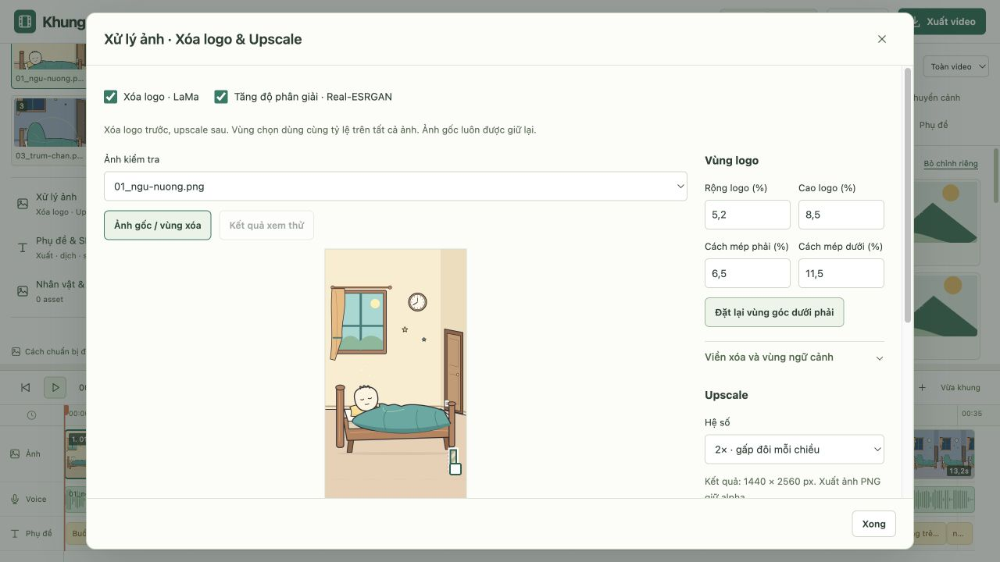
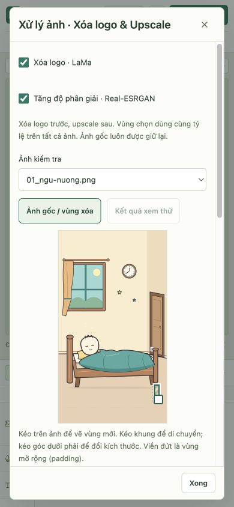

# Xử lý ảnh hàng loạt

## Kế hoạch

- Tích hợp `delete_logo.py`, `lama_fp32.onnx` và `image_upscaler.py` vào một cửa sổ Xử lý ảnh.
- Bật/tắt xóa logo và upscale độc lập, thứ tự xóa logo trước rồi upscale.
- Chọn vùng bằng chuột trên ảnh nguyên bản; phần trăm kích thước, khoảng cách mép phải/dưới, padding và feather cập nhật hai chiều. Xem thử một ảnh trước khi chạy toàn bộ.
- Giữ nguyên nguồn gốc, xử lý lại luôn từ nguồn; không nhân kích thước nhiều lần. Cache, tiến độ, dừng và khôi phục ảnh gốc.
- Tùy chọn tự chạy cấu hình đã lưu cho ảnh nhập mới. Lưu cấu hình cùng dự án và mẫu dựng.
- Dùng `.venv` uv chung. Không cài thư viện hoặc tải trọng số trong lượt triển khai.

## Cài đặt (người dùng tự chạy)

```sh
uv sync
# Chỉ cần nếu dùng upscale 2x:
npm run setup:images -- --scale 2
# Chỉ cần nếu dùng upscale 4x:
npm run setup:images -- --scale 4
```

`uv sync` dùng `.venv` chung với Whisper và deep-translator. `pyproject.toml` và `uv.lock` đã cập nhật cho OpenCV headless, ONNX Runtime, Pillow, NumPy và Torch. Không cần torchvision/basicsr/facexlib. Lệnh setup chỉ tải trọng số của hệ số đã chọn, không tự cài thư viện hoặc tạo venv khác.

- LaMa dùng file có sẵn **`lama_fp32.onnx` tại gốc dự án** (208.044.816 byte). Không tải lại khi import module.
- Real-ESRGAN: `.cache/models/realesrgan/RealESRGAN_x2plus.pth` và `RealESRGAN_x4plus.pth`. Nếu đã có trong `weights/`, vẫn dùng được. Không tự tải model khi bấm xử lý; thiếu model có hướng dẫn trong UI.
- LaMa chạy ONNX Runtime CPU. Upscaler ưu tiên CUDA → MPS → CPU. Chế độ Tự động có fallback CPU khi thiết bị tăng tốc gặp lỗi; ép thiết bị sẽ báo lỗi thay vì âm thầm đổi.

## Cách dùng

1. Thêm ảnh như hiện tại, mở **Xử lý ảnh** ở cột tài nguyên. Bật Xóa logo, Upscale hoặc cả hai.
2. Chọn ảnh kiểm tra. Kéo trên ảnh để tạo vùng xóa mới; kéo trong khung để di chuyển; kéo góc dưới phải để thay đổi kích thước. Có thể tập trung khung bằng Tab và dùng phím mũi tên (Shift để tăng bước).
3. Các ô **Rộng/Cao logo (%)**, **Cách mép phải/dưới (%)** cập nhật hai chiều. Chỉnh kích thước bằng ô số giữ mép phải/dưới làm mốc, tương đương các tham số ratio trong file gốc.
4. Tọa độ X/Y và rộng/cao pixel ở ảnh gốc hiện ngay dưới ảnh. Ví dụ rộng 5,2% nghĩa là khoảng 52 pixel trên ảnh rộng 1.000 pixel.
5. Mở **Viền xóa và vùng ngữ cảnh** khi cần: padding mở rộng mask (viền đứt), feather làm mềm bên trong mask, context bổ sung nền xung quanh để LaMa suy ra chi tiết. Các giá trị này tính bằng pixel gốc, không phải pixel trên màn hình.
6. **Xem thử ảnh này** chỉ tạo kết quả so sánh, chưa thay ảnh đang dựng. Chuyển **Ảnh gốc / vùng xóa** và **Kết quả xem thử** để xem. Đổi thông số làm kết quả cũ không còn được dùng để so sánh.
7. **Xử lý toàn bộ N ảnh** áp dụng cấu hình theo tỷ lệ cho toàn bộ ảnh. Ảnh thành công được cập nhật vào preview/timeline; lỗi liệt kê theo file, ảnh lỗi vẫn giữ bản đang dùng.
8. Bật **Tự xử lý ảnh nhập mới** để dùng cấu hình khi nhập/thêm ảnh lần sau. Chỉ ảnh mới được xử lý khi bấm Thêm ảnh. Nếu môi trường hoặc model chưa đủ, ảnh gốc vừa nhập vẫn được giữ và có thông báo lỗi.
9. **Khôi phục tất cả ảnh gốc** hoàn tác việc xử lý, giữ cấu hình để dùng lại. Cấu hình lưu trong draft/dự án và mẫu dựng.

## Logic và giới hạn

- Thứ tự: xóa logo → upscale → PNG. Không ghi đè nguồn. PNG giữ alpha, không nén JPEG thêm lần nữa; kết quả là ảnh 8-bit.
- `Asset.original` giữ src/kích thước nguồn; ID và tên ảnh giữ nguyên để ghép voice/TXT và các chỉnh riêng theo cảnh không đổi. Chạy lại luôn từ nguồn, tránh upscale lũy tiến. Cấu hình và nguồn còn sau khi dựng lại/lưu mở dự án.
- Model LaMa cố định 512×512: lấy vùng ngữ cảnh quanh mask, resize đúng tensor 512², nội suy kết quả về crop rồi chỉ ghép trong vùng mask mở rộng. Không chỉ cắt góc phải như file cũ. Pixel ngoài mask mở rộng giữ nguyên; alpha giữ nguyên.
- Upscaler sửa padding cho ảnh kích thước lẻ khi dùng mạng 2x và xử lý tile.
- Một batch tối đa 300 ảnh; nguồn tối đa 25 MB/ảnh và 40 megapixel. Kết quả tối đa 40 megapixel, mỗi chiều không quá 30.000 px. Upscale 4x tăng số pixel 16 lần, nên có thể vượt giới hạn với ảnh lớn.
- Vùng chọn là một hình chữ nhật dùng chung tỷ lệ, không tự nhận diện logo và chưa có vùng riêng cho từng ảnh. Với ảnh khác bố cục, xem nhiều ảnh trong dropdown trước khi áp dụng.
- Cache `.cache/images/`: theo byte ảnh gốc, cấu hình, phiên bản thuật toán và SHA-256 trọng số. Kết quả `data/uploads/<sha256>.png`. Cache xem thử được dùng lại khi chạy toàn bộ.
- Một Python worker cho cả batch, giữ model trong bộ nhớ. Kết quả tạm ở thư mục hệ thống `khung-images-*`, dọn cả khi lỗi/hủy. Có tiến độ và nút Dừng; hủy không thay ảnh trong dự án. Cache/kết quả thành công trước đó có thể còn trên đĩa để dùng lại.
- Model `.onnx` đã được Git theo dõi từ commit người dùng; quy tắc ignore mới không tự gỡ file đã theo dõi. Không thay/xóa model nguồn trong lượt này.

## Kiểm tra và trạng thái thực tế

Build, ESLint/TypeScript và 21 kiểm tra model/story/image qua, trong đó 3 nhóm mới kiểm tra hình học frontend/Python, lưu mở/giữ nguồn/dựng lại, cache, lỗi một phần và hủy qua worker giả lập. Python đã kiểm tra cú pháp. IPC với `.venv` thật báo đúng thiếu thư viện. UI desktop/mobile đã kiểm tra kéo vùng và chỉnh số hai chiều; nút chạy khóa khi thiếu môi trường.

**Chưa chạy suy luận LaMa/Real-ESRGAN hoặc đánh giá chất lượng ảnh**: máy hiện thiếu `cv2`, `onnxruntime`, `PIL`; chưa có trọng số upscale. Không cài thư viện hay tải model trong lượt này. Chỉ cập nhật uv.lock bằng thông tin registry. Cần người dùng chạy các lệnh trên rồi xem thử một ảnh trước. Server kiểm tra đã tắt.

Tham khảo: [LaMa FP32, đầu vào 512×512](https://huggingface.co/Carve/LaMa-ONNX), [Real-ESRGAN](https://github.com/xinntao/Real-ESRGAN).



